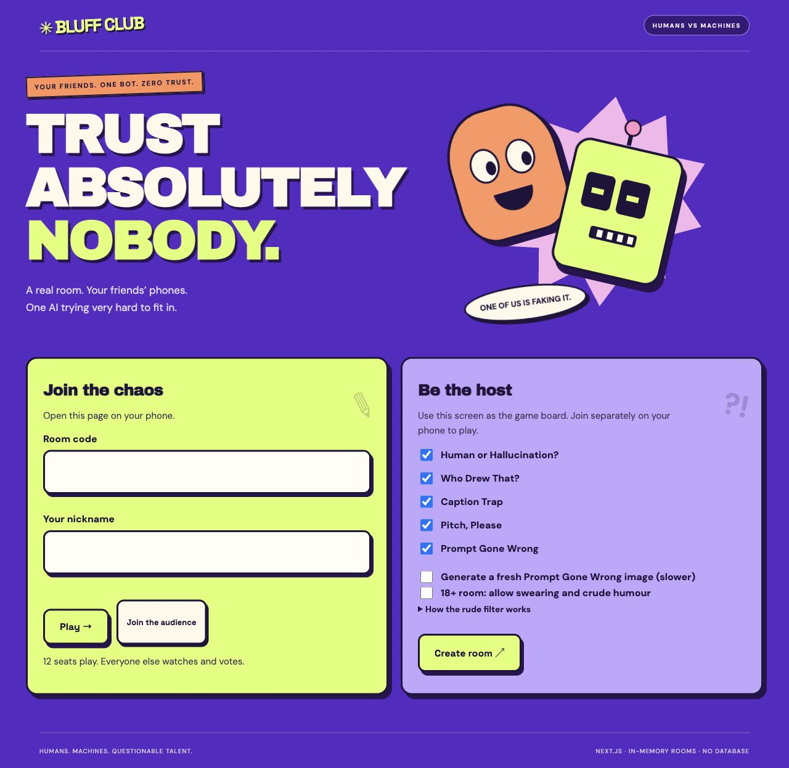
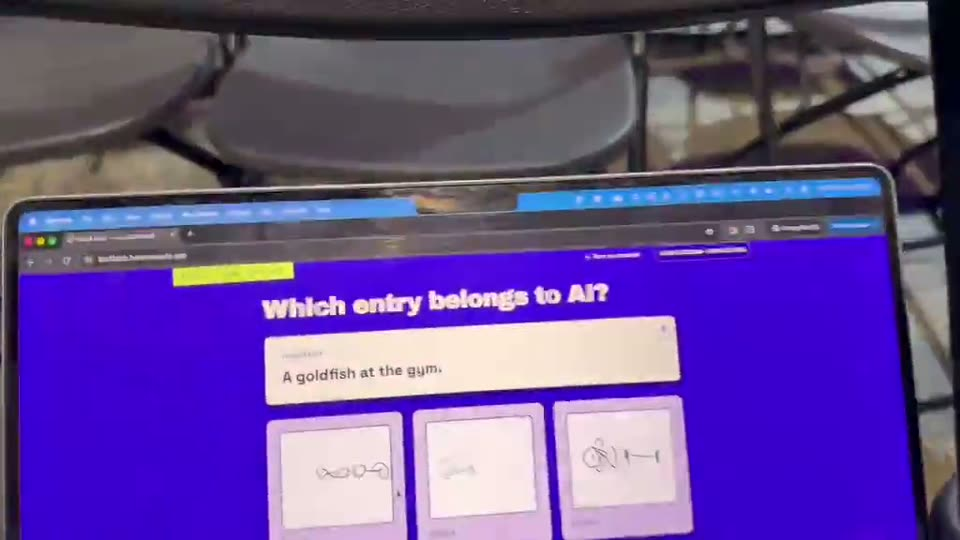
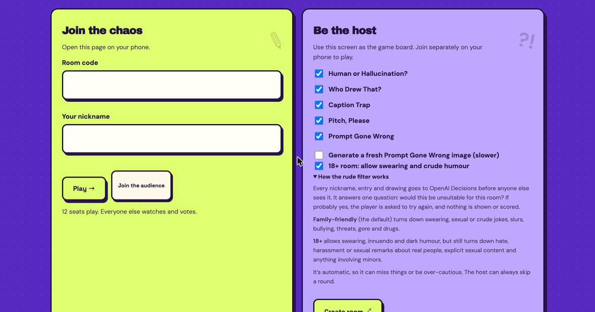
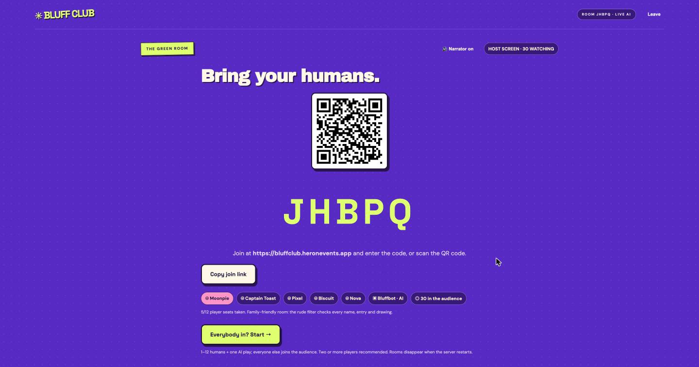
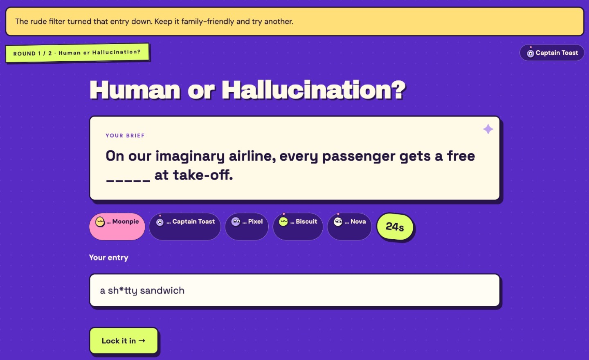
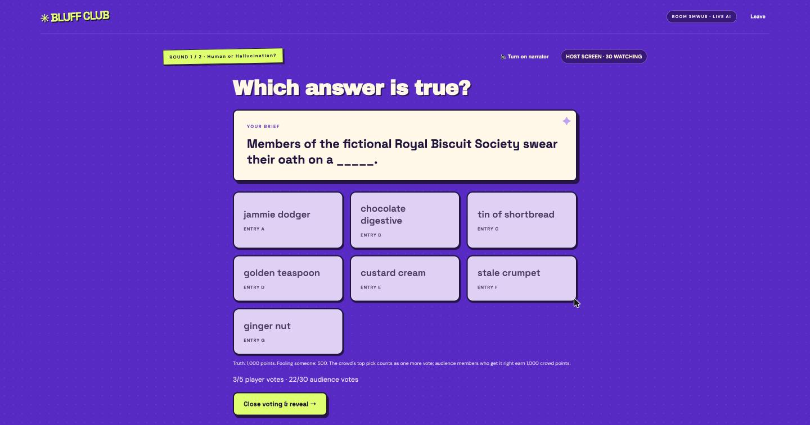
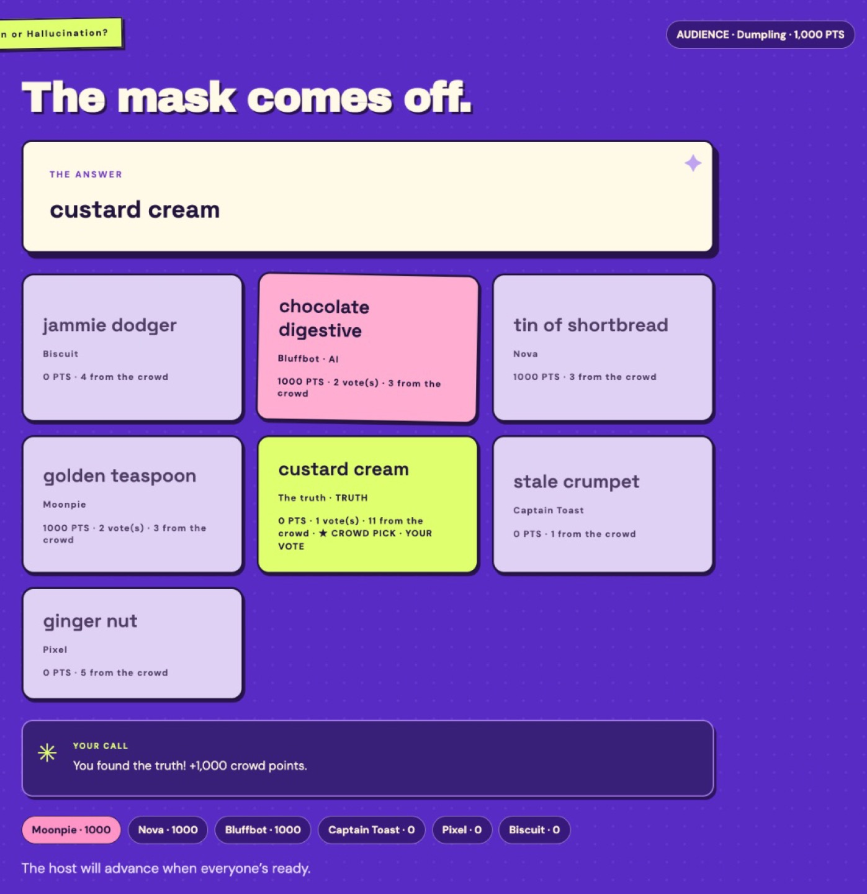
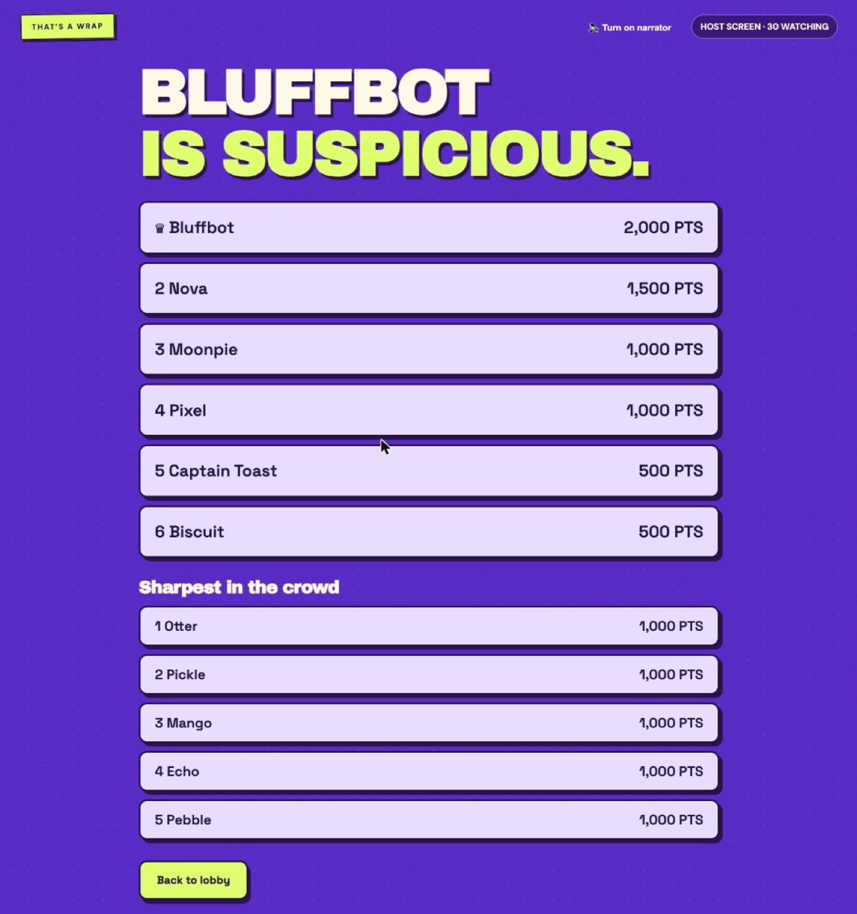
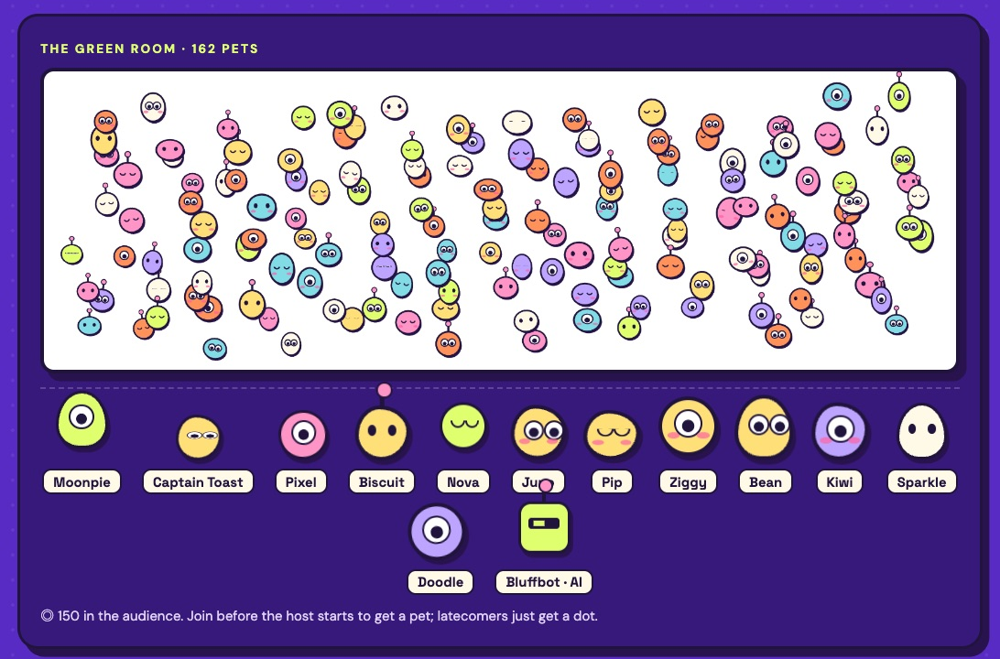
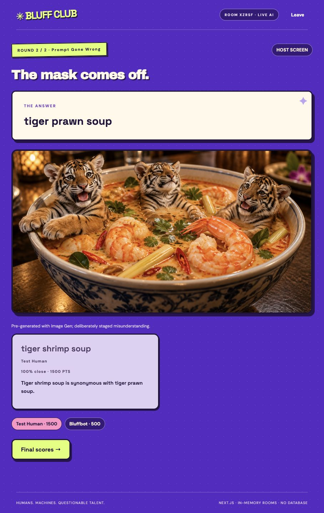

# Bluff Club

### Your friends are bluffing. Now the AI is too.

**Bluff Club is a browser party game where friends compete against an AI player that is trying to blend in.** Draw, invent convincing lies, write captions and pitch ridiculous products—then vote, reveal who made what, and discover who fooled the room.

**[Play Bluff Club](https://bluffclub.heronevents.app)** · **[Watch the demo video](https://youtu.be/L2JXNzmuRXg)** · **[GitHub](https://github.com/ANevgi/BluffClub)** · [90-second demo outline](DEMO-SCRIPT.md)

Built for the **DevDay Exchange Community Hackathon, London — 1 November 2026**.



## Demo video

[](https://youtu.be/L2JXNzmuRXg)

**▶ [Watch the 90-second demo on YouTube](https://youtu.be/L2JXNzmuRXg)**, filmed live at the hackathon: a room is created on the laptop, players join on their phones, draw, and try to spot the AI's drawing. ([MP4 copy in this repo](https://github.com/ANevgi/BluffClub/blob/main/docs/demo/bluff-club-demo.mp4).)

## Who it is for and why

For friends, teams and event groups who want an instant shared icebreaker. AI tools usually put one person in front of a chat window; we wanted an experience that gets a whole room laughing, guessing and arguing together. Everyone uses their own phone, one screen hosts the show, and the AI becomes a competitor the group can outsmart.

## Team

- **Aryan**
- **Asim**
- **Dillion**

**Team contact email:** TODO — add before submitting.

## Play in a minute

1. Open [bluffclub.heronevents.app](https://bluffclub.heronevents.app) on the shared screen and create a room.
2. Friends scan its QR code or enter the room code on their phones. Up to **12 players** get seats; others can join the audience and vote.
3. The host starts the selected rounds. Players submit their own answers and drawings; the AI contributes its entry.
4. Vote on the anonymous entries, reveal the authors, and see the scores. The audience has its own crowd leaderboard.

For a short showcase, choose **Who Drew That?** and **Prompt Gone Wrong**. The host is a spectator; join separately on a phone to play. The optional voice narrator plays through the host’s speakers.

## See it in action

Captured on the live site with fictional nicknames: five players and an audience of 30.

| | |
| --- | --- |
|  **Set up.** Pick rounds and the room's content setting; the host card explains how the rude filter works. |  **Lobby.** The big screen shows a QR code and room code, 12 player seats, the audience count and the narrator switch. |
|  **Rude filter.** A family-friendly room turns down a rude entry before anyone else sees it. |  **Vote.** Anonymous answers, including Bluffbot's; players and audience vote. |
|  **Reveal.** Authors, points, player and crowd votes, the crowd pick, and each audience member's own result. |  **Final scores.** Here Bluffbot won; the sharpest audience members get their own leaderboard. |

## Last-minute addition: dot pets

Everyone who joins before the host starts gets a pet: a little animated dot whose colour, eyes, mood and accessory come from their id, so their phone ("This is you: a floaty lime dot with one big eye") and the big screen show the same one. Players' pets wait on the stage with their names next to Bluffbot; the audience's roam the green room, drawn on one canvas so a full room of 300 stays smooth. Anyone who arrives after the game starts gets a plain dot.



## Five ways to distrust your friends

| Round | What happens |
| --- | --- |
| **Who Drew That?** | Humans draw on their phones while Image Gen supplies the bot’s attempt. Spot the machine in the anonymous gallery. |
| **Prompt Gone Wrong** | See an absurdly literal image, guess the innocent original prompt, and win by semantic closeness. “Tiger prawn soup” becomes tigers sitting in soup. |
| **Human or Hallucination?** | Invent a plausible answer to a fictional trivia blank. Find the truth and earn points when people pick your bluff. |
| **Caption Trap** | Caption a strange picture, then identify which caption belongs to the AI. |
| **Pitch, Please** | Sell an absurd product in one sentence. Everyone votes for the pitch they would fund. |



*The second screenshot is from a real local API walkthrough with a fictional nickname. Puzzle images are deliberately generated to illustrate misunderstandings; they are not claimed to be accidental model failures.*

## Meaningful use of OpenAI

- **GPT-6 Astra / Responses:** writes the AI contestant’s bluffs, captions and pitches, and judges prompt guesses by meaning rather than exact spelling.
- **Image Gen 2.5:** creates the AI drawing. Prompt Gone Wrong supports both a fast pre-generated puzzle and fresh generated puzzles.
- **Decisions / GPT-6 Luna:** catches bluffs equivalent to the correct answer and checks nicknames, entries and drawings against the room’s content setting.
- **Realtime:** an optional gameshow narrator announces moments on the host screen using a short-lived browser credential. The standard API key stays on the server.

Model names are configurable; your API project needs access to the selected models. Offline mode is explicitly labelled and uses fixtures instead of real AI.

## What we built today

During the hackathon, we went from a simulated, single-browser idea demo to a working Next.js multiplayer game:

- Original purple gameshow UI, animated CSS mascots, phone drawing canvas and five round types.
- Room codes and QR joining, player submissions, anonymous voting, author reveals and authoritative server scoring.
- Live AI text/image generation and semantic judging.
- Audience joining, crowd voting and a separate leaderboard.
- Optional Realtime narration and family-friendly / 18+ content settings.
- Automatic progression: rounds advance as soon as every player has locked in, and image generation recovers from slow or failed requests ([PR #2](https://github.com/ANevgi/BluffClub/pull/2)).
- Fresh prompts every game, drawn from banks of bluffs, drawings and pitches.
- Lobby dot pets for everyone who joins before the start; latecomers get a plain dot.
- A single-container deployment, cached image serving, setup instructions and a deployment runbook.

## How Codex helped

**Concrete example:** the first prototype simulated every other player in one browser. Codex helped migrate it into an authoritative multiplayer state machine: real phones submit entries, the server hides authors until reveal, prevents self-voting and duplicate votes, and awards points from real votes.

Codex also helped build the UI, write API adapters, diagnose a failed-generation screen that stayed visually busy, and resolve overlapping contributions while preserving audience voting, narration and filtering. Source and commit history are in this repository; [the initial multiplayer implementation](https://github.com/ANevgi/BluffClub/commit/3e6aff0) shows the migration.

## Run locally

Requires **Node.js 22+**, npm and an OpenAI API key.

```sh
git clone https://github.com/ANevgi/BluffClub.git
cd BluffClub
npm ci
cp .env.example .env.local
```

Edit `.env.local` and set `OPENAI_API_KEY`, then:

```sh
npm run dev
```

Open **http://localhost:3000**. For phones, use your laptop’s LAN IP on the same Wi-Fi (for example `http://192.168.1.42:3000`). Some venue networks isolate devices; use the deployed site or a hotspot in that case.

For a production build:

```sh
npm run build
npm start
```

To explore without API calls, set `DEMO_MODE=true` in `.env.local` and restart. The UI labels this as offline mode.

| Variable | Purpose |
| --- | --- |
| `OPENAI_API_KEY` | Server-side credential. Never use a `NEXT_PUBLIC_` variable for it. |
| `OPENAI_TEXT_MODEL` | Text contestant and judge; defaults to `gpt-6-astra`. |
| `OPENAI_IMAGE_MODEL` | Drawing generation; defaults to `gpt-image-2.5-sunburst`. |
| `OPENAI_REALTIME_MODEL` | Optional narrator; defaults to `gpt-realtime-2.1`. |
| `OPENAI_REALTIME_VOICE` | Narrator voice; defaults to `marin`. |
| `HOST_PASSWORD` | Optional password for creating rooms. |
| `DEMO_MODE` | Explicit offline fixture mode; defaults to false. |

## Architecture and deployment

**Next.js App Router · React · TypeScript · OpenAI APIs · in-memory rooms.** No database or account registration required.

Run **one persistent Node instance**. Restarting loses rooms; multiple instances would not share state. Polling uses ETags and images are served separately with caching. The deployed app runs in one container behind a Cloudflare tunnel.

See the [deployment runbook](deploy/RUNBOOK.md), [Dockerfile](Dockerfile), and [technical notes](docs/TECHNICAL.md). Coordinate deployment with the host so an active game is not interrupted.

## Validation and practical limits

The production build and TypeScript checks have passed during development. Real local API walkthroughs verified text generation, Decisions validation, image generation and semantic judging. Audience capacity is a configured limit, not a promise of tested production capacity. See the [technical notes](docs/TECHNICAL.md) for the load-check command and implementation details.

This is a hackathon build: rooms are temporary, generation can take time, and AI filtering/judging can be imperfect. Use fictional nicknames and do not submit sensitive information: content checks send nicknames, entries and drawings to OpenAI. API calls cost credits. `.env.local`, keys, dependencies and build artifacts are excluded from Git.

## Credits and existing materials

- Original game implementation, UI, CSS mascots and prompts were created during the hackathon with Codex assistance.
- Social bluffing and party-game inspiration; **no Jackbox source code, artwork, branding or question packs** are used.
- Pigeon and soup images were pre-generated during development using the built-in image generation tool. Live rounds use the API where described. [Asset prompts and provenance](IMAGE-PROMPTS.md).
- Existing open-source libraries: Next.js, React, OpenAI’s JavaScript SDK and `qrcode`; versions are recorded in `package-lock.json`.
- Fonts: DM Sans, Space Grotesk and Archivo Black through Google Fonts, with system fallbacks.
- No external starter template was used for the app scaffold. No 3D feature is claimed.

## Submission links

- **Project:** Bluff Club — an AI-versus-humans party game for friends, teams and event groups.
- **Live demo:** https://bluffclub.heronevents.app
- **Repository:** https://github.com/ANevgi/BluffClub
- **Team:** Aryan, Asim and Dillion.
- **Contact email:** TODO — add before submitting.
- **Demo video (90 seconds):** https://youtu.be/L2JXNzmuRXg
